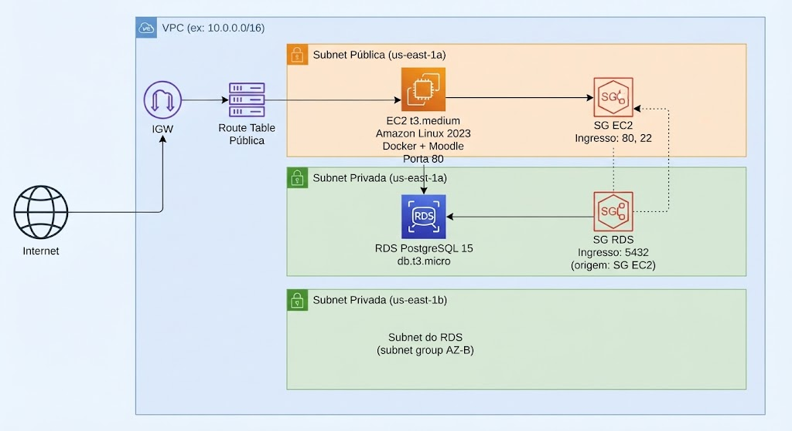

# Template: Design de Arquitetura

> **Instruções:**
> 1. Faça uma cópia deste arquivo com o nome `docs/architecture-design.md` — **esse é o arquivo que você deve entregar**.
> 2. Preencha cada seção substituindo os blocos `<!-- TODO: ... -->` pelo conteúdo real da sua solução.
> 3. Não apague os títulos das seções — eles são verificados automaticamente na avaliação.
> 4. O diagrama deve cobrir, no mínimo: VPC, subnets públicas e privadas, EC2, RDS, Security Groups e o fluxo Internet → IGW → EC2 → RDS.

---

## Visão Geral

<!-- TODO: Descreva em 2–4 parágrafos a solução que você implementou. Explique o objetivo da infraestrutura, quais serviços AWS foram provisionados, como o Moodle é executado na instância EC2 e como ele se conecta ao banco de dados RDS. Mencione também as decisões de alto nível que guiaram a sua implementação. -->

## Diagrama de Arquitetura

<!-- TODO: Substitua o bloco de exemplo abaixo pelo diagrama real da sua solução.
     Você deve usar um diagrama com imagens de serviço comforme exemplo na imagem.

     O diagrama deve cobrir obrigatoriamente:
       - VPC com o CIDR definido
       - Subnet pública (EC2) e subnets privadas (RDS — mínimo 2 AZs)
       - Internet Gateway e Route Table pública
       - Instância EC2 (t3.medium) na subnet pública
       - Instância RDS PostgreSQL 15 (db.t3.micro) na subnet privada
       - Security Group para EC2 (portas 80 e 22)
       - Security Group para RDS (porta 5432, origem: SG EC2)
       - Fluxo de acesso externo: Internet → IGW → EC2 → RDS

     Exemplo de estrutura (adapte conforme sua implementação real):
-->

<!-- TODO: Substitua o diagrama acima pelo diagrama real da sua solução. -->

## Decisões de Design

<!-- TODO: Preencha a tabela abaixo justificando cada escolha técnica da sua implementação.
     Adicione ou remova linhas conforme necessário para cobrir todas as suas decisões.
     Explique *por que* você fez cada escolha, não apenas *o que* você escolheu.
-->

| Componente | Escolha | Justificativa |
|---|---|---|
| Tipo de instância EC2 | `t3.medium` | <!-- TODO: Justifique a escolha (ex.: recursos suficientes para Moodle, custo compatível com AWS Learn Lab) --> |
| Engine do banco de dados | RDS PostgreSQL 15 | <!-- TODO: Justifique (ex.: compatibilidade com ambiente Docker local, suporte no AWS Learn Lab) --> |
| Classe da instância RDS | `db.t3.micro` | <!-- TODO: Justifique (ex.: custo mínimo, suficiente para carga de estudo) --> |
| AMI da EC2 | Amazon Linux 2023 | <!-- TODO: Justifique (ex.: AMI atualizada, suporte a Docker via dnf) --> |
| Topologia de rede | 1 subnet pública + 2 privadas | <!-- TODO: Justifique (ex.: EC2 pública para acesso HTTP/SSH; RDS privado por segurança; 2 AZs exigidas pelo subnet group do RDS) --> |
| Acesso IAM na EC2 | LabRole via data source | <!-- TODO: Justifique (ex.: restrição do AWS Learn Lab — sem criação de IAM roles) --> |

## Componentes

<!-- TODO: Descreva cada componente AWS que você provisionou com o Terraform.
     Para cada componente, informe: nome/identificador, tipo, configuração relevante e qual papel ele cumpre na solução.
     Use a estrutura abaixo como ponto de partida e adapte conforme os recursos reais do seu projeto.
-->

### VPC

<!-- TODO: Descreva a VPC (CIDR block, region, DNS hostnames habilitado ou não, etc.). -->

### Subnets

<!-- TODO: Liste cada subnet com: nome, tipo (pública/privada), CIDR, AZ e qual recurso ela hospeda. -->

### Internet Gateway e Route Table

<!-- TODO: Descreva o Internet Gateway e a Route Table pública, incluindo a rota 0.0.0.0/0 → IGW. -->

### Security Group — EC2

<!-- TODO: Descreva as regras de ingresso e egresso do Security Group da EC2 (portas liberadas, origem do tráfego). -->

### Security Group — RDS

<!-- TODO: Descreva as regras do Security Group do RDS (porta 5432, origem restrita ao SG da EC2). -->

### Instância EC2

<!-- TODO: Descreva a instância EC2: tipo, AMI, subnet, key pair, LabRole, user_data.sh e o que é executado no boot. -->

### RDS PostgreSQL

<!-- TODO: Descreva a instância RDS: engine version, classe, armazenamento (GB), multi-AZ, publicly_accessible, subnet group. -->

## Segurança

<!-- TODO: Descreva as medidas de segurança implementadas na sua solução. Aborde pelo menos:
     - Isolamento de rede (RDS em subnet privada, sem acesso público)
     - Regras de Security Group com princípio do menor privilégio
     - Gerenciamento de credenciais (uso de variáveis sensíveis no Terraform, sem hardcode)
     - Acesso SSH restrito a CIDR específico
     - Uso do LabRole via data source (sem criação de IAM users/roles adicionais)
-->

## Escalabilidade

<!-- TODO: Descreva as considerações de escalabilidade da sua solução. Aborde pelo menos:
     - Limitações atuais do ambiente AWS Learn Lab (single AZ para EC2, db.t3.micro, etc.)
     - Como a arquitetura poderia ser escalada em um ambiente de produção real (ex.: Auto Scaling Group, Multi-AZ RDS, Load Balancer, etc.)
     - Quais mudanças no Terraform seriam necessárias para escalar a solução
-->

## Custo Estimado

<!-- TODO: Preencha a tabela abaixo com a estimativa de custo mensal da sua solução na região us-east-1.
     Use a AWS Pricing Calculator (https://calculator.aws/) para obter os valores.
     Considere o uso contínuo (730 horas/mês) para instâncias On-Demand.
-->

| Serviço | Tipo/Configuração | Custo estimado (USD/mês) |
|---|---|---|
| EC2 | `t3.medium`, On-Demand, 730h | <!-- TODO: preencha --> |
| RDS PostgreSQL | `db.t3.micro`, 20 GB SSD, 730h | <!-- TODO: preencha --> |
| Armazenamento EBS (EC2) | <!-- TODO: tamanho em GB --> GB gp3 | <!-- TODO: preencha --> |
| Transferência de dados | <!-- TODO: estimativa de GB/mês --> GB saída | <!-- TODO: preencha --> |
| **Total estimado** | | <!-- TODO: some os valores acima --> |

> Referência: [AWS Pricing Calculator](https://calculator.aws/) — use o link para obter valores atualizados e gerar um link compartilhável da sua estimativa.

<!-- TODO: Adicione o link gerado pelo AWS Pricing Calculator para a sua estimativa específica. -->
