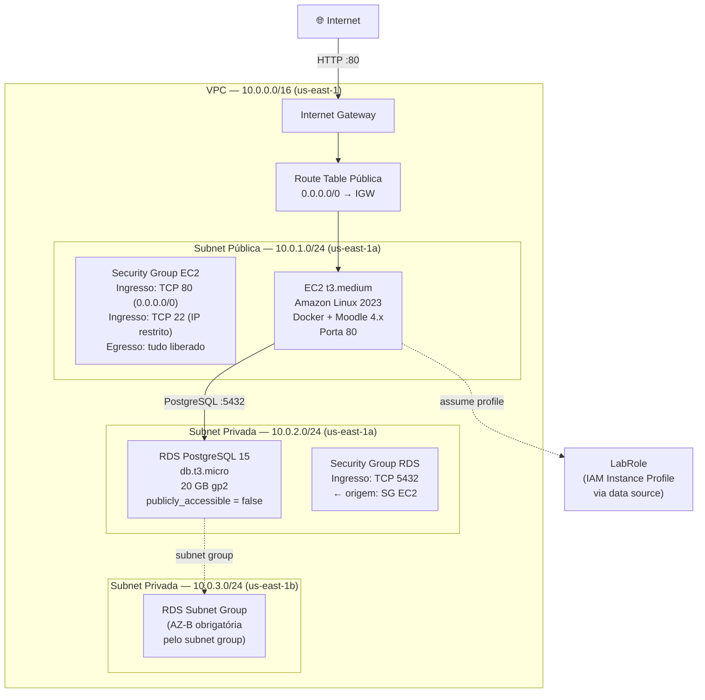
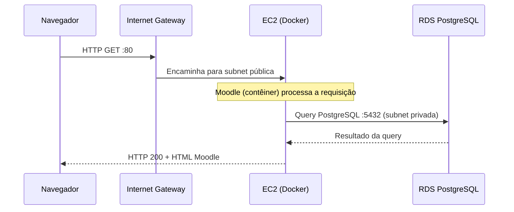

# Arquitetura de Referência — Moodle na AWS

> **Documento destinado a professores e monitores.**
> Este arquivo descreve a arquitetura esperada que o aluno deve provisionar com Terraform.
> Não é entregue pelo template como código funcional — serve como gabarito de avaliação.

---

## Visão Geral

A solução implanta o Moodle 4.x em uma instância EC2 (`t3.medium`) rodando Docker, conectada a um banco de dados gerenciado RDS PostgreSQL 15 (`db.t3.micro`) em subnet privada. Toda a infraestrutura é provisionada via Terraform na região `us-east-1` do AWS Learn Lab, respeitando as restrições de permissão desse ambiente (sem criação de IAM roles, sem Route 53, ACM ou CloudFront).

O acesso externo ao Moodle se dá pela porta 80 do DNS público da EC2. Não há HTTPS nativo — a restrição do AWS Learn Lab impede o uso do ACM — sendo o DNS público do EC2 a alternativa aceita para o ambiente educacional.

---

## Diagrama da Arquitetura

> **Nota:** o RDS não possui subnet pública nem IP público. A segunda subnet privada (`us-east-1b`) é exigida pelo recurso `aws_db_subnet_group`, que precisa de ao menos 2 AZs distintas — não há instância RDS ativa nela.

---

## Componentes AWS

| Componente | Recurso Terraform | Configuração-chave |
|---|---|---|
| VPC | `aws_vpc` | CIDR `10.0.0.0/16`, `enable_dns_hostnames = true` |
| Subnet pública | `aws_subnet` | `10.0.1.0/24`, `us-east-1a`, `map_public_ip_on_launch = true` |
| Subnet privada AZ-A | `aws_subnet` | `10.0.2.0/24`, `us-east-1a` |
| Subnet privada AZ-B | `aws_subnet` | `10.0.3.0/24`, `us-east-1b` (subnet group) |
| Internet Gateway | `aws_internet_gateway` | Associado à VPC |
| Route Table pública | `aws_route_table` | Rota `0.0.0.0/0 → IGW` |
| Security Group EC2 | `aws_security_group` | Ingresso: TCP 80 e 22; egresso: irrestrito |
| Security Group RDS | `aws_security_group` | Ingresso: TCP 5432 apenas do SG EC2 |
| Instância EC2 | `aws_instance` | `t3.medium`, AMI Amazon Linux 2023, `user_data.sh` instala Docker e sobe Moodle |
| RDS PostgreSQL | `aws_db_instance` | `db.t3.micro`, engine `postgres` v15, `publicly_accessible = false` |
| Subnet Group RDS | `aws_db_subnet_group` | Subnets privadas AZ-A e AZ-B |
| LabRole (data) | `data "aws_iam_instance_profile"` | Referencia o perfil existente `LabRole` sem criar recursos IAM |

---

## Fluxo de Dados

O tráfego de entrada chega via Internet Gateway, atravessa a Route Table pública e alcança a instância EC2. O Moodle rodando em Docker realiza queries ao RDS pela rede privada da VPC — o RDS nunca é exposto diretamente à internet.

---

## Decisões de Design

| Decisão | Escolha | Justificativa |
|---|---|---|
| Compute | EC2 `t3.medium` | 2 vCPUs e 4 GB RAM suficientes para o Moodle em carga educacional; tipo `t3` disponível no AWS Learn Lab |
| Banco de dados | RDS PostgreSQL 15, `db.t3.micro` | Compatibilidade com o ambiente Docker local (postgres:15); `db.t3.micro` é o menor tipo disponível — minimiza custo no crédito do Lab |
| AMI | Amazon Linux 2023 | AMI mantida pela AWS, com suporte a Docker via `dnf`; alinhada com a documentação de user data do template |
| Sem Auto Scaling | Single EC2 | Restrição do AWS Learn Lab: LabRole não tem permissão para criar Launch Templates e Auto Scaling Groups de forma confiável; escopo educacional não exige HA |
| IAM via data source | `data "aws_iam_instance_profile"` para `LabRole` | O AWS Learn Lab proíbe criação de IAM roles, policies e instance profiles; o LabRole pré-existente deve ser referenciado como data source |
| Sem HTTPS | DNS público EC2 na porta 80 | ACM e CloudFront são bloqueados no AWS Learn Lab; a instrução de segurança do `CHALLENGE.md` orienta o aluno sobre essa limitação |
| Topologia de rede | 1 pública + 2 privadas | EC2 pública para acesso HTTP/SSH; RDS em subnet privada por segurança; 2 AZs distintas são obrigatórias para `aws_db_subnet_group` |
| Backend Terraform | Arquivo local (padrão) ou S3 | O `backend.tf.example` orienta o uso do S3 + DynamoDB, mas não é obrigatório no Lab — o aluno decide |

---

## O Que Avaliar na Entrega do Aluno

Ao revisar o repositório do aluno, verifique os seguintes pontos:

1. **Módulos Terraform preenchidos** — `networking/`, `compute/` e `database/` devem ter blocos `resource` funcionais, sem `# TODO:` pendentes nos recursos principais.
2. **`user_data.sh` funcional** — deve instalar Docker 24+, Docker Compose v2 e executar `docker compose up -d`.
3. **`docs/architecture-design.md` entregue** — arquivo gerado pelo aluno a partir do `architecture-design-template.md`, com diagrama próprio e seções preenchidas.
4. **Segurança básica** — porta 5432 do RDS restrita ao SG EC2; SSH com CIDR específico (não `0.0.0.0/0`); sem credenciais no código.
5. **LabRole via data source** — nenhum bloco `resource "aws_iam_role"` ou `resource "aws_iam_instance_profile"` nos módulos.
6. **Health check passando** — `scripts/health-check.sh <EC2_DNS>` retorna exit 0.
7. **CI verde** — workflows `terraform-validate.yml` e `docker-lint.yml` passando no repositório do aluno.

---

## Referências

- [Moodle 4.x System Requirements](https://moodledev.io/docs/gettingstarted/requirements)
- [AWS Learn Lab — Restrições de permissão](docs/aws-learn-lab-setup.md)
- [Terraform AWS Provider ~> 5.0](https://registry.terraform.io/providers/hashicorp/aws/latest)
- [Template de Arquitetura do Aluno](architecture-design-template.md)
- [Rubrica de Avaliação](evaluation-rubric.md)
